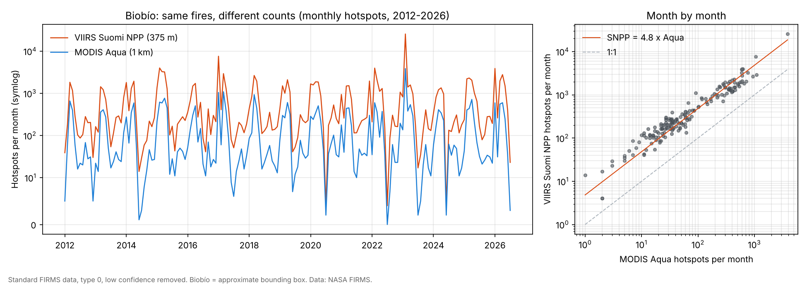

# Overlap

**Two satellites. One honest burning calendar.**

Overlap harmonizes 25 years of NASA FIRMS active-fire hotspots from MODIS (1 km) and VIIRS (375 m) into one consistent burning activity calendar for any area of interest, and shows how much to trust each number.

NASA Space Apps Challenge 2026 · Challenge: *Harmonization of MODIS and VIIRS Hot Spots* · Local event: Concepción, Chile.

> **Design principle:** nothing is shown without its uncertainty, and no detection is not the same as no fire.

> Work in progress during the hackathon (November 14–15, 2026).

## In two minutes

| | |
| --- | --- |
| **Problem** | Satellites have tracked active fires for 25 years, but the record is split between MODIS (since 2000) and VIIRS (since 2012). VIIRS sees smaller fires: in Biobío, Chile, it records about 4.8 times more hotspots than MODIS Aqua for the same months. Joining both series without treatment creates a false jump in 2012. MODIS ends in 2027 and Suomi NPP stopped delivering new data on November 2, 2026. |
| **For whom** | Early warning and emergency responders, firefighters, scientists and land managers. |
| **Solution** | A harmonization engine calibrated on the MODIS–VIIRS overlap, and a web app with a month × year calendar, the current month against the historical median, anomalies and a CSV download for any area. |
| **Measured result** | Checked against 76,002 CONAF fire records (2002–2020, Maule, Ñuble, Biobío, Araucanía): joining MODIS and VIIRS without treatment creates a false ×4.7 jump at 2012 relative to real fire activity; after harmonization it is ×0.89 (95 % CI 0.77–1.07: no jump). On hidden years 2020–2026, quantile mapping reconstructs Suomi NPP from MODIS Aqua better than a simple ratio in all four regions (typical monthly error about ×1.5). In the other regions with enough CONAF fires (Coquimbo to Los Lagos), the false jump also disappears in 6 of 8 as used in the app; Valparaíso is overcorrected and Metropolitana keeps part of the jump ([all regions](results/validation_conaf/all_regions/README.md)). Large fires (≥ 200 ha) in Biobío: 88 % detected by MODIS Aqua and 97 % by VIIRS (hotspot within 3 km and 3 days). Details: [results/harmonization_qmap](results/harmonization_qmap/README.md), [results/validation_conaf](results/validation_conaf/README.md). |
| **Try it** | https://contactomtingcl.github.io/overlap/ (no login) |

## Repository

| Folder | Content |
| --- | --- |
| `pipeline/` | Python scripts, run in order (`01_…`, `02_…`) |
| `results/` | Tables and figures produced by the pipeline; every number in our submission comes from here |
| `app/` | Static web app (no server, no login) |
| `docs/` | Data sources, method and AI use |
| `data/` | Raw FIRMS downloads (not committed; see `data/README.md`) |

## First result

Same fires, different counts: both sensors rise and fall together, but VIIRS records about 4.8 times more hotspots. The ratio is not constant: it is larger in quiet months and smaller in big fire months, so a single fixed factor is not enough. That is why we use quantile mapping.

## Harmonization used in the app (v1)

- **Maule, Ñuble, Biobío, La Araucanía:** quantile mapping on log(1 + monthly hotspots) with the R package `qmap`, one map per region and sensor, fitted on the overlap 2012–2026 (`pipeline/07`, `09`), validated on hidden years (`pipeline/07`, `08`) and against CONAF (`pipeline/10`). The app reproduces these values exactly (`pipeline/03`).
- **Nine other regions:** one quantile map fitted on Maule, Ñuble, Biobío and La Araucanía together, applied region by region (never to a national total). Tested on hidden years 2020–2026 in the 12 regions it never saw, it beats each region's own simple ratio in 9 of 12 (MODIS Aqua median error ×2.1 against ×3.0) (`pipeline/11`, `results/harmonization_qmap/pooled`).
- **Los Ríos, Los Lagos, Aysén:** the pooled map did worse there (few or different fires), so they keep a simple ratio on the overlap. All 12 were also checked against CONAF (`pipeline/15`, `results/validation_conaf/all_regions`): the jump disappears in Coquimbo, O'Higgins, Los Ríos, Los Lagos and Aysén; Valparaíso is overcorrected (years before 2012 about 35 % too high) and Metropolitana undercorrected (about 43 % too low); the north and Magallanes have too few CONAF fires to judge. The app shows this per region.
- **Sensitivity analysis (candidate for v2):** a daily quantile map with day and night overpasses separated (`pipeline/06`, `results/harmonization`) lowers the error further in Biobío (mean error 176 hotspots per month against 326 for the simple ratio).

## Data processing rules

1. Only standard (science-quality) FIRMS data in the historical series; the last 2–3 months (near real-time) are marked as provisional.
2. Only `type = 0` (presumed vegetation fire). Volcanoes, static land sources (mining, industry) and offshore detections are removed.
3. Low-confidence detections are removed (MODIS < 30, VIIRS "low").
4. Dates and times in UTC.
5. Raw counts from different sensors are never added together, and VIIRS satellites are never summed with each other.

## Beyond the calendar (what the harmonized record makes possible)

- **Season clock** (`pipeline/17`): start (10 %), busiest month and end (90 %) of every fire season, with Theil-Sen trends and the Mann-Kendall test. A shift counts as confirmed only if it also appears in the VIIRS-only seasons. Example: in O'Higgins the busiest month moved from autumn to summer (about 59 days earlier per decade, confirmed in VIIRS-only years); the cause is not established (agricultural burning practices are one hypothesis).
- **Scenarios, not forecasts**: the current season plus what each past season added afterwards gives a 10–90 % band for the end of the season. We checked whether the start of a season anticipates the rest (`pipeline/16`): in the fire regions it does not, so the app says so.

## Known limitations

1. **Polar satellites see each place only about twice a day** (one daytime and one night overpass per satellite). Fires that start and end between overpasses, or that burn under clouds or thick smoke, are missed. No detection is not the same as no fire.
2. **Pixel size grows towards the edge of the swath** (MODIS: from 1 km at nadir to about 4 km), where only larger or hotter fires are detected. We do not correct for viewing angle yet.
3. **Hotspots are thermal anomalies, not fires:** one large fire produces many hotspots; small agricultural, waste or short-lived fires may produce none. Autumn (April–May) holds about 31 % of hotspots but about 2 % of CONAF burned area; agricultural burning is the likely explanation (hypothesis, not yet verified).
4. **Harmonization uncertainty:** the MODIS Aqua map underestimates monthly totals by 10–17 % on hidden years; months with very few hotspots and the Terra-only months (2000–2002) are the least certain. Outside Maule–Araucanía errors are larger (typical monthly error about ×1.8–3.0); against CONAF, Valparaíso is overcorrected, Metropolitana undercorrected, and the north and Magallanes cannot be judged.
5. **Recent months are provisional** (near real-time data), and are withheld over the Atacama desert, where near real-time data hold many daytime false detections.

## Roadmap

- Own quantile maps for Valparaíso and Metropolitana (where the pooled map is off against CONAF), and a daily day/night model (v2, see `results/harmonization`).
- Geostationary detections (GOES ABI, every few minutes over South America, available in FIRMS) to fill the hours between polar overpasses and the morning orbit that Terra leaves in 2027.
- Independent check of large events with MODIS/VIIRS burned-area products and Sentinel-2/Landsat scars.
- Pre-fire context for anticipating critical periods: vegetation (NDVI), soil moisture and precipitation anomalies.
- Alerts to the responsible agency when an area's current month becomes unusual.

## Team

Overlap: Matías Navarro, Karla Palomino, Benjamín Arriagada.

## Data and acknowledgments

We acknowledge the use of data and/or imagery from NASA's Fire Information for Resource Management System (FIRMS) (https://earthdata.nasa.gov/firms), part of NASA's Earth Science Data and Information System (ESDIS). Details in [docs/DATA.md](docs/DATA.md). Background on satellite fire detection from NASA ARSET training "Satellite Observations and Tools for Fire Risk, Detection, and Analysis" (Spanish edition). AI use is declared in [docs/AI_USE.md](docs/AI_USE.md).
